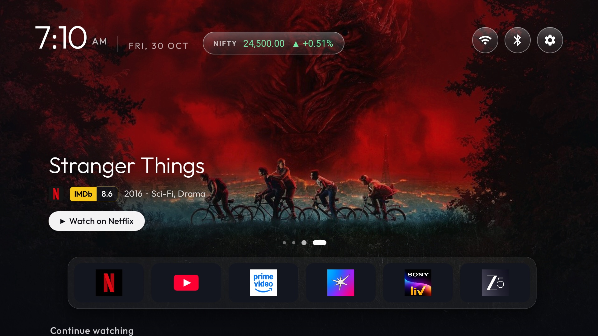
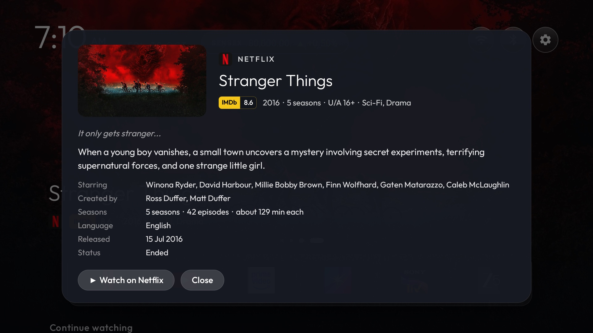
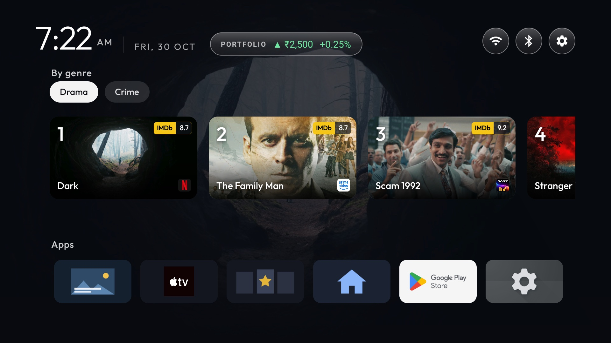
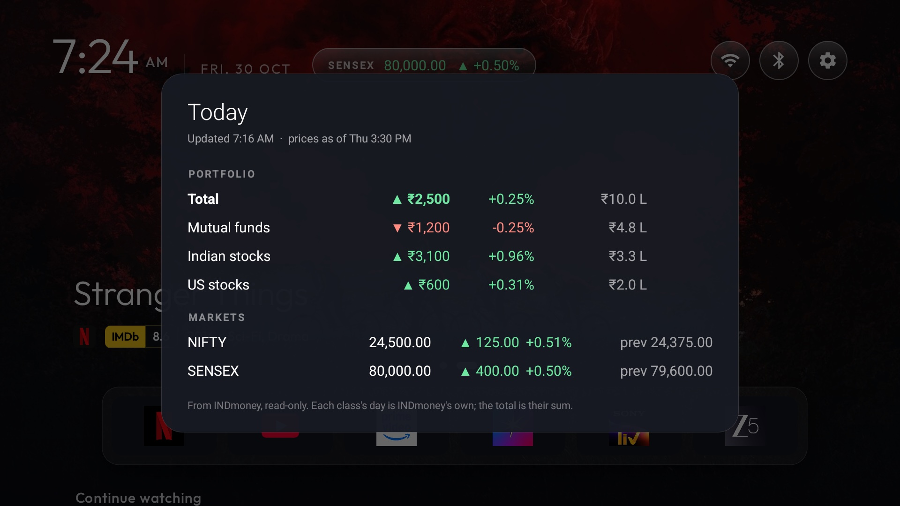
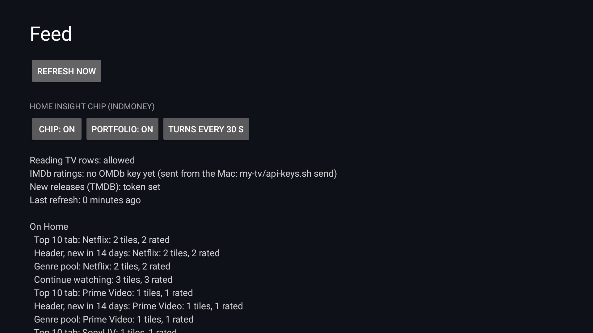
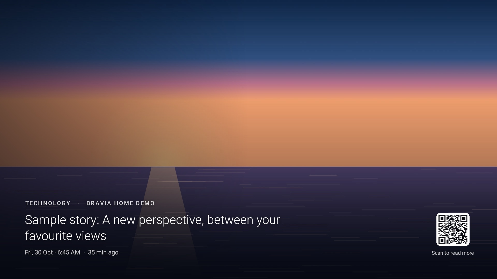
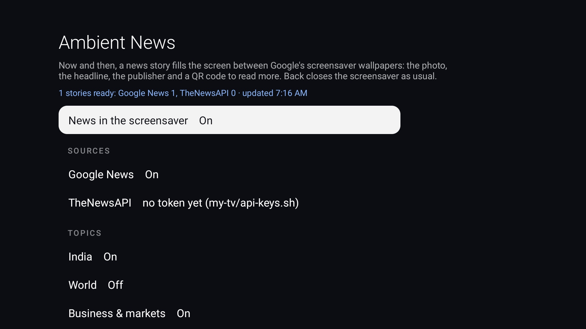

<div align="center">

# BRAVIA Home

### Your streaming apps. Your home screen.

A cinematic, ad-free launcher for Android TV and Google TV.<br>
New releases, IMDb ratings and Continue watching—with optional portfolio insights and news between your screensaver wallpapers.

**No sponsored rows · Offline launcher · Optional connected add-ons · Remote-first controls**

[Explore Home](#a-home-screen-built-around-your-apps) · [Portfolio & markets](#portfolio--markets-optional) · [Ambient News](#ambient-news-optional) · [Customise](#make-it-yours) · [Install](#set-it-up)

</div>



<sub>Screenshots show the current interface running in an Android TV emulator. Catalogue selections and viewing progress are sample data; all portfolio values and market quotes are fictional. The news slide is a labelled demonstration, not a real headline. No personal account data or credentials are pictured.</sub>

Built and running on **Sony BRAVIA BF1 · Google TV 12**, with India's streaming services. Other Android TV / Google TV devices need their own compatibility checks, especially for inputs, remote keys and screensaver overlays.

## A home screen built around your apps

### A different backdrop for every service

Focus an app in the glass drawer and the header follows it: new releases from that service, with artwork, IMDb rating, year, genres and season information. Read more opens the plot and other details. The clock and glass controls sit over the artwork; a soft shade keeps the text readable.

The carousel turns every eight seconds. Press **Up** to focus it, **Left / Right** to browse, and **OK** to open the selected item. It pauses while focused. App-provided links can open a title directly; catalogue-only items fall back to opening the service.

For streaming services, the header selects up to 15 titles: five top picks and ten drawn from the remaining new releases, with a new draw on refresh. It normally looks back 14 days, or 30 for Apple TV. If the focused app has nothing new, it mixes picks from the drawer's other services.

YouTube gets its own treatment: recent Subscriptions and Recommended videos published to the TV, then Trending. These are the rows YouTube exposes to Android TV, not a copy of its complete in-app feed.

### Read more, without leaving Home

Hold **OK** on a title for its plot, tagline, cast, director or creators, runtime, seasons and episodes, language, release date and India's age rating where available. Details are fetched on demand from TMDB and cached for a week.



### Pick up where you left off

Continue watching brings together the apps that publish Watch Next entries, with progress bars, IMDb tags and service badges. Hold **OK** to remove an entry locally; it stays hidden across restarts and returns when the app publishes a newer watch event.

Each drawer app also has a tab under **Top 10**. Move between service tabs to change the row; the focused title's type, genres and year appear below it. These rows combine app-published recommendations and catalogue popularity—they are not guaranteed to match a streaming service's official Top 10 chart.


### Browse by genre

Drama, Comedy, Action, Sci-Fi and other available genres draw from your drawer's services in turn, so one large catalogue does not fill the whole row. Paired genre names are normalised, and duplicate titles are reduced.



### Arrange the apps you actually use

Your favourites stay on one line; the tiles shrink to fit. Hold **OK** on a favourite for **Open**, **Move**, **Remove from favourites** or **App info**. Everything else lives under Apps, where holding **OK** offers **Add to favourites**.


The top bar includes the clock, short date, refresh progress, Inputs, Wi-Fi, Bluetooth and Settings. Bluetooth opens the TV's **Remotes & Accessories** settings. Available input controls depend on the TV.

## Portfolio & markets (optional)

One small chip beside the date cycles through **PORTFOLIO → NIFTY → SENSEX**, one view at a time. It stops rotating while focused. Press **OK** for the expanded view; the information stays compact until you ask for more.



The portfolio shows the combined one-day movement of **Mutual funds, Indian stocks and US stocks**, plus each asset class's current value, rupee change and percentage change. Nifty 50 and Sensex show the level, daily movement, previous close and quote time.

Both portfolio and index data come from **INDmoney's official, read-only MCP connector**. This implementation does not need Kite, an always-on computer, or a separate data bridge. Initial sign-in happens on INDmoney's own page on your computer; the pairing script hands the grant to the TV, which renews it itself while the provider permits it. If the grant is refused, repeat the sign-in and pairing scripts; there is currently no TV QR reconnect flow.

**These are periodically refreshed snapshots, not a tick-by-tick market feed.** When Home requests stale data, the add-on refreshes after 15 minutes during its weekday daytime window, or after an hour otherwise. The schedule is not an exchange holiday calendar. Mutual funds, Indian shares and US shares can have different valuation times. Cached figures remain available after a failed refresh, with their saved status/time in the details.

Open **Apps → Feed** to customise the chip:

| Setting | Choices |
|---|---|
| Insight chip | On / Off |
| Portfolio | On / Off; Off omits the portfolio from display and subsequent holdings fetches, leaving only the indices |
| Rotate every | 10 / 20 / 30 / 60 seconds |



No financial connection is needed for the rest of Home. Even in indices-only mode, the current connector needs your INDmoney authorisation. Missing asset classes are omitted; the displayed total covers the classes actually returned, rather than every asset in your net worth.

## Ambient News (optional)

Keep **Google's existing Ambient screensaver**. Between its wallpapers, Ambient News occasionally fades in a full-screen story: a large photo, topic, publisher, headline, publication time and a QR code to read the original article on your phone. It then fades away and Google's wallpapers continue.



The image above is the actual overlay rendered with an illustrative story over the emulator's clock screensaver; the installed BRAVIA setup keeps Google Ambient. The overlay never takes focus or intercepts touches. **Back** exits the screensaver normally, and the news slide is removed when the screensaver stops. This is a separate optional add-on, not a replacement wallpaper feed.

Two independently switchable connectors are included:

- **Google News:** no account or API key. Reads English-language India topic pages, then retrieves the publisher's lead image. This is a page-based connector, so changes to Google's or a publisher's markup can affect it.
- **TheNewsAPI:** optional personal API token from [thenewsapi.com](https://www.thenewsapi.com/). This is **TheNewsAPI**, not NewsAPI.org. It supplies article metadata and image links.

Stories older than a day and photos smaller than 1,000 pixels wide are skipped. Stories and photos are cached on the TV. Fetching runs hourly while the screen is on; TheNewsAPI is limited to three requests per refresh and a local daily cap of 90. Repeated settings changes or restarts still count toward the cap. Check your provider plan's current quota.



Open **Apps → Ambient News** to choose:

| Setting | Choices |
|---|---|
| News in the screensaver | On / Off |
| Connectors | Google News and TheNewsAPI independently On / Off; TheNewsAPI needs a token |
| Topics | India, World, Business & markets, Technology, Sports, Entertainment, Science, Health |
| Time between stories | Random gap of 30–90 seconds, 1–3 minutes, 3–6 minutes or 5–10 minutes |
| Time on screen | 15 / 20 / 30 seconds |
| Preview | Start the screensaver now and show a story after a few seconds, when one is ready |

India, Business & markets and Technology start enabled; other topics start disabled. The default gap is 1–3 minutes and a story stays for 20 seconds. Screensaver overlays were built for the BRAVIA setup; verify behaviour on another model before leaving the service enabled.

## Make it yours

Three places control different parts of the experience:

| Where | What you can change |
|---|---|
| Hold OK on an app | Favourite selection, app order and app information |
| Apps → Feed | Insight chip, portfolio visibility, chip rotation and Refresh now |
| Apps → Ambient News | News enabled, connectors, topics, frequency, duration and preview |
| Hold OK on Settings → Launcher settings | General launcher appearance and system shortcuts; some layout controls belong to the classic launcher rather than the Feed layout |
| [my-tv/theme/config.json](my-tv/theme/config.json) | Default drawer apps, hidden apps, Feed selection and applicable theme options |

[Customisation guide](docs/CUSTOMIZATION.md) explains the controls, current theme, fixed Feed-layout behaviour and advanced configuration reference. New owners can use streaming Home without enabling either optional add-on.

## How it works

```text
Streaming apps ── Watch Next / preview rows ──┐
TMDB / JustWatch ── titles and artwork ───────┤
StreamRatings / OMDb ── IMDb ratings ─────────┼── Feed add-on ── local provider ── Launcher
INDmoney MCP ── portfolio / index snapshots ──┘                                  (offline)

Google News / TheNewsAPI ── Ambient News add-on ── overlays during Google Ambient
```

- **Launcher:** no internet permission. Reads local Feed data; the provider accepts only apps signed with the same key.
- **Feed:** handles content, artwork, ratings, on-demand details and the optional INDmoney connection. Content refreshes on demand; it has no background service.
- **Ambient News:** owns its own network access, overlay permission and foreground service. It listens for screensaver start/stop and screen-off events, and starts again after reboot when enabled.
- **Original Home:** optional shortcut to the stock launcher. It works only while that launcher is enabled; use the restore/switch script if it was disabled during hand-over.

| Data | Refresh / cache behaviour |
|---|---|
| Watch Next and app-published recommendations | Re-read on content refresh, normally when Home data is older than 20 minutes |
| TMDB new releases and popular titles | Six-hour response cache |
| Genre pools / new seasons | 24-hour / 12-hour response caches |
| Read more details | On demand, cached one week |
| IMDb ratings | 3–30 days by release age; missing titles retried after five days |
| Portfolio and indices | On demand: 15 minutes during the weekday daytime window, one hour otherwise |
| News | Hourly while the screen is on; eligible stories from the last day |
| Artwork | Cached locally and loaded as needed |

Home opens with saved rows immediately, then refreshes asynchronously. A progress indicator appears under the date while the content refresh runs.

### Where recommendations come from

Continue watching and app-published recommendation rows depend on the installed apps and their signed-in accounts. Netflix and SonyLIV do not publish rows in the tested setup, so their discovery tabs use TMDB's popular catalogue titles in India. Header selections and genre pools are catalogue discovery rather than personalised viewing recommendations.

TMDB selects recent original releases and new seasons, not the date an older film joined a service. If TMDB is unavailable or unconfigured, the header can fall back to JustWatch's new additions in India; its definition of newness therefore differs. Weekly episodes from an older season do not automatically make a TMDB title new.

## Set it up

Use an **Android TV / Google TV running Android 8 or newer**, a computer on the same network, JDK 17, Android SDK platform 34 and build-tools 34. Network debugging is needed during installation. The tested setup is Sony BRAVIA BF1 with Google TV 12; this is not a universal TV compatibility claim.

[Docker build instructions](tools/docker-build.md) are available if you do not have the local Java/Android toolchain.

### 1. Install streaming Home

```bash
git clone https://github.com/rohan9405/bravia-home.git
cd bravia-home
python3 -m venv tools/venv
tools/venv/bin/pip install -r tools/requirements.txt
export TV_HOST='<tv ip>'

# Installs without disabling the stock launcher automatically.
STOCK_LAUNCHER=none launcher/build-and-install.sh
tools/install-addon.sh tv-feed
tools/venv/bin/python -I tools/tv.py 'pm grant io.github.rohan9405.feed android.permission.READ_TV_LISTINGS'
tools/theme.sh my-tv/theme

# Optional shortcut; the stock launcher must remain enabled for it to open.
tools/install-addon.sh original-home
```

Use your own TV address. Configure `JAVA_HOME` and `ANDROID_HOME` for your toolchain before building. Verify Home opens correctly, along with streaming apps, HDMI, audio and the remote, before any stock-launcher hand-over or cleanup. The Sony-specific procedure and restore commands are in [my-tv/README.md](my-tv/README.md).

For catalogue artwork and title details, save your own TMDB read token locally. OMDb is used for ratings:

```bash
my-tv/api-keys.sh save tmdb
my-tv/api-keys.sh save omdb
my-tv/api-keys.sh send
```

The scripts prompt for keys; do not paste them into committed files. With no TMDB token, the header can use the JustWatch fallback; full genre discovery and Read more metadata need TMDB.

### 2. Optional: portfolio and market insights

```bash
python3 my-tv/indmoney-signin.py
my-tv/indmoney-pair.sh
```

Complete sign-in on INDmoney's own page. The scripts keep local credentials outside the repository and hand the grant to the TV. Open **Apps → Feed** to switch the chip or portfolio off, or change rotation. Repeat these scripts if INDmoney requires a new sign-in; automatic renewal cannot override revoked or expired authorisation.

### 3. Optional: news in Google Ambient

```bash
tools/install-addon.sh ambient-news
tools/venv/bin/python -I tools/tv.py 'appops set io.github.rohan9405.ambient SYSTEM_ALERT_WINDOW allow'

# Only for the second connector; Google News does not need a key.
my-tv/api-keys.sh save news
my-tv/api-keys.sh send
```

Open **Apps → Ambient News**, choose connectors and topics, let stories download, and use **Start the screensaver now** to preview. Google News can be used on its own; the second connector is optional.

### 4. Optional: Sony cleanup, with undo

The tested [debloat list](my-tv/debloat.txt) disables selected Sony promos/tracking, feedback/demo packages and preloaded apps. It disables packages for the user; it does not uninstall them. Back up first, inspect the list for your exact TV, and follow [the Sony setup notes](my-tv/README.md). AdGuard DNS is optional and does not remove YouTube ads.

Turn network debugging off after setup and verify it with `python3 tools/adb-closed.py <tv ip>`. [Troubleshooting](docs/TROUBLESHOOTING.md) covers device differences.

<details>
<summary><strong>Preview in an emulator</strong></summary>

An Android TV emulator can run the same launcher. The built-in Feed demo supplies sample rows when no streaming apps are present:

```bash
adb shell am start -n io.github.rohan9405.feed/.FeedActivity --ez demo true
```

Use `--ez demo false` to return to app-published rows. This switch supplies catalogue samples only; it does not connect a financial account or generate the README's financial fixtures. The README captures use public title artwork, sample progress and fictional portfolio/index data in an isolated preview environment. They demonstrate layout rather than current recommendations, live quotes or investment performance.

</details>

## Privacy and permissions

Your own sign-in and keys stay in private app storage and the local setup directory (`~/.cleantv-private`), outside this repository. They are not included with screenshots. Treat that directory and device backups as private; the current pairing/storage implementation does not claim hardware-backed credential encryption.

| Component | Access and purpose |
|---|---|
| Launcher | Offline UI; device/remote capabilities depend on enabled configuration |
| Feed | Internet for content, artwork, ratings and optional INDmoney; TV listings for published recommendations and Watch Next |
| Ambient News | Internet, display-over-other-apps, foreground service and boot receiver for screensaver stories |
| Original Home | No requested permissions; opens an available stock Home app |

No ads, sponsored rows or app analytics are added by this project. Connected features send requests to their providers; those providers and linked article/image hosts receive the normal network metadata. Portfolio data comes directly from INDmoney to the TV, not through this repository's owner. Disabling the portfolio stops subsequent holdings fetches; it is not a token-revocation or cache-erasure action.

## Switching back

| What | Command |
|---|---|
| Make stock Home the default | `TV_HOST=<tv ip> tools/switch-home.sh stock` |
| Switch back to BRAVIA Home | `TV_HOST=<tv ip> tools/switch-home.sh clean` |
| Undo the Sony setup, including DNS and screensaver changes | `TV_HOST=<tv ip> my-tv/restore.sh` |
| Reset the applied theme | `TV_HOST=<tv ip> tools/theme.sh --reset` |
| Disable news only | Apps → Ambient News → News in the screensaver → Off |
| Hide portfolio or all insights | Apps → Feed → Portfolio / Insight chip → Off |

## Current limits

- App and catalogue data vary by service, region and firmware. A title can open the app's home screen when no usable title link exists.
- Watch Next coverage depends on each app. Removing an item affects BRAVIA Home, not the service's own watch history.
- Portfolio figures and indices are snapshots with different source timestamps, not a continuously streaming trading terminal. Missing asset classes are omitted.
- INDmoney can require renewed sign-in. The current recovery path uses the computer scripts, not a TV QR code.
- Ambient News depends on Android overlay/screensaver behaviour, usable publisher photos and connector availability. Google News page parsing can break after upstream changes.
- Drip spending, cricket cards and financial insights on the screensaver are not implemented here. Today's finance feature is the Home insight chip and its detail popup.

## Credits

Built on [CleanYourTV](https://github.com/Gathin23/cleanyourtv) by Gathin23 and contributors, including the launcher foundations, device tools and safety checks. MIT licence; see [LICENSE](LICENSE).

Ratings use OMDb and the StreamRatings shared cache. Titles, artwork and metadata use TMDB, with a JustWatch fallback for new releases. This product uses the TMDB API but is not endorsed or certified by TMDB. Optional financial data uses INDmoney's official MCP; news uses Google News, TheNewsAPI and the original publishers. This project is independent of Sony and these service providers.
